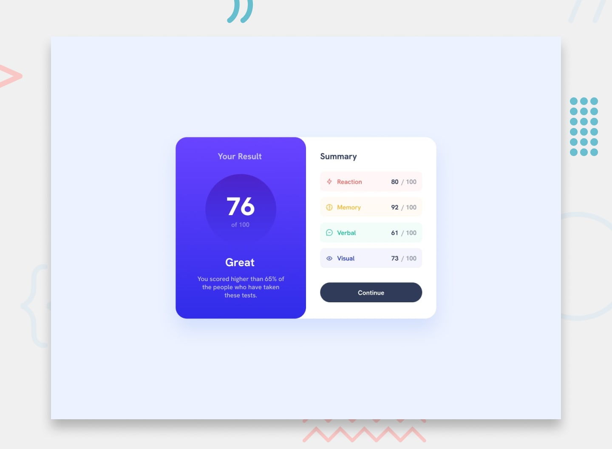

# Results Summary Component

A responsive Results Summary Component built as part of a Frontend Mentor challenge.

## Overview

This project recreates the Results Summary Component design using HTML and CSS with a mobile-first approach.

### Features

- Responsive mobile and desktop layouts
- CSS custom properties (variables)
- Flexbox layout
- Local font loading with @font-face
- Hover state for the action button

## Screenshot

## Built With

- HTML5
- CSS3
- Flexbox
- Mobile-First Workflow

## What I Learned

During this project I practiced:

- Building layouts using Flexbox
- Creating responsive designs with media queries
- Using CSS variables to manage colors
- Loading local fonts with @font-face
- Structuring CSS using reusable component classes

## Continued Development

Future improvements:

- Load scores dynamically from the provided JSON file
- Improve accessibility and focus states
- Add smoother hover transitions

## Author

- GitHub - [Pryassin](https://github.com/Pryassin)
- Frontend Mentor - Your Frontend Mentor Profile

## Live Site

Add your deployed URL here after publishing with GitHub Pages, Vercel, or Netlify.